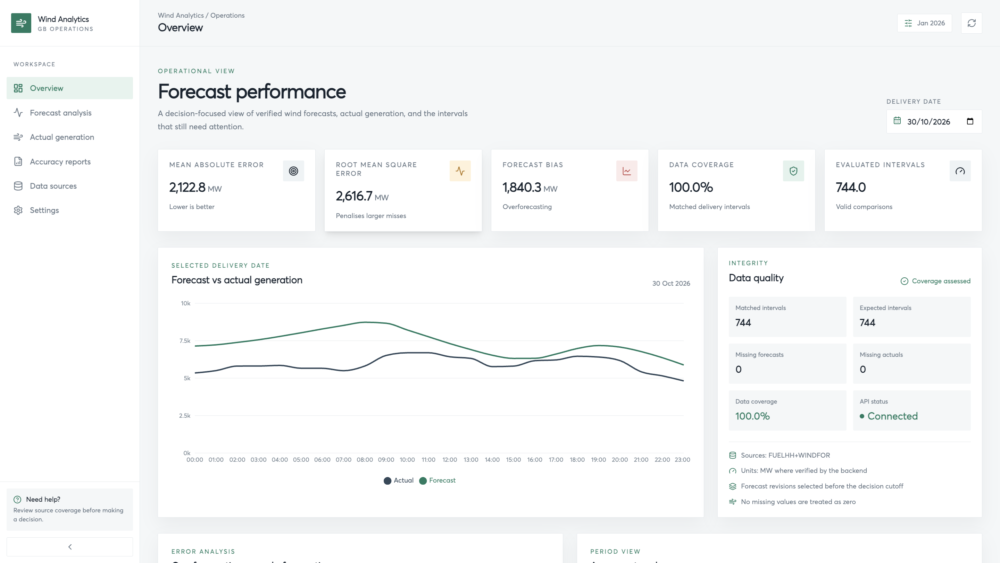
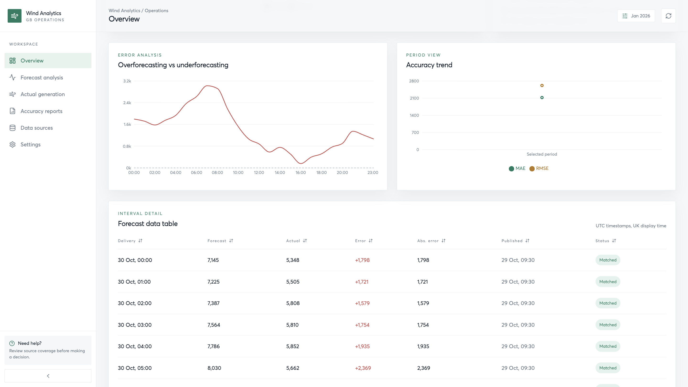
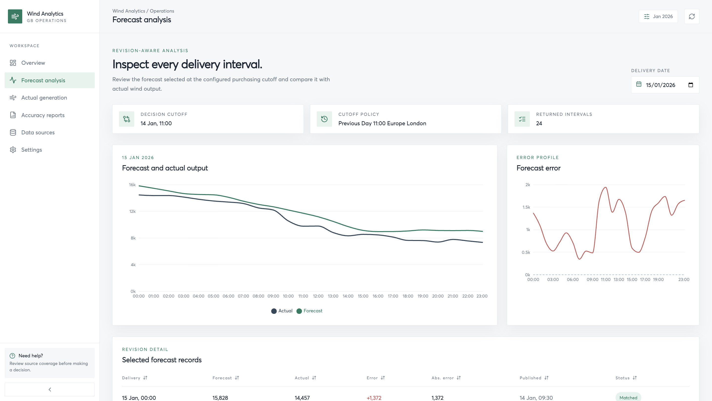
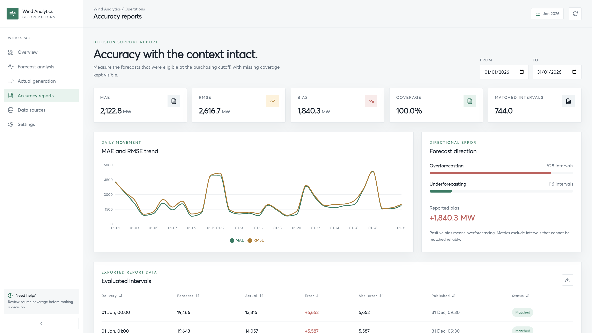
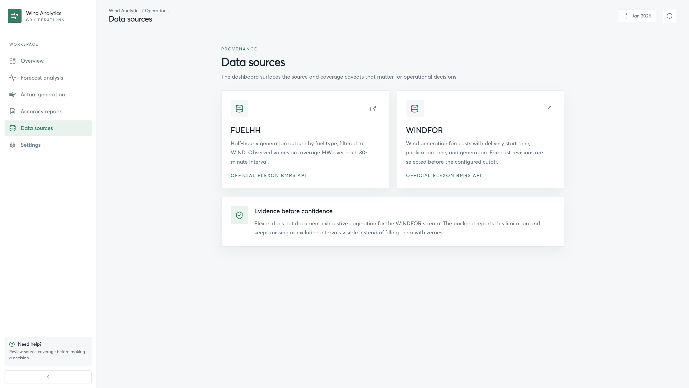

# Wind Analytics Backend

This folder is the complete FastAPI project. It reads Elexon BMRS FUELHH and WINDFOR data, selects the latest forecast revision available at the configured day-ahead cutoff, matches forecast intervals with actual generation, and calculates accuracy metrics.

## Backend flow

1. `app/clients/elexon_client.py` asynchronously calls the official Elexon API with `httpx`, retries bounded transient failures, and caches responses briefly.
2. `app/services/data_service.py` fetches the requested delivery data and coordinates selection.
3. `app/services/forecast_selection.py` converts timestamps to UTC, applies the Europe/London cutoff policy, and selects the latest eligible WINDFOR publication per delivery interval.
4. `app/services/accuracy_service.py` normalizes half-hourly FUELHH actuals to the hourly WINDFOR granularity, matches records, and calculates MAE, RMSE, and bias.
5. `app/api/routes/` exposes typed FastAPI responses for the dashboard.

The default cutoff is `previous_day_11:00_europe_london`. Missing values are excluded from metrics, never replaced with zero. Elexon does not document exhaustive historical WINDFOR revision pagination, so responses report coverage limitations.

## Start locally

Run these commands from this `backend/` directory:

```bash
python3 -m venv .venv
source .venv/bin/activate
python -m pip install -r requirements.txt
cp .env.example .env
python -m uvicorn app.main:app --reload --host 127.0.0.1 --port 8000
```

Open `http://127.0.0.1:8000/docs`. Stop the server with `Ctrl+C` and leave the environment with `deactivate`.

## Validate

```bash
python -m compileall -q app tests
python -m pytest -q
python -m ruff check app tests
# Wind Analytics Backend

FastAPI backend for a wind-generation forecast accuracy dashboard. The service reads forecast and actual generation data from the official Elexon BMRS API, selects the correct day-ahead forecast revision, compares it with delivered generation, and exposes typed endpoints for the dashboard.

This is an interview-purpose implementation: it is intentionally small, easy to run locally, and focused on the core data and accuracy workflow.

## Previews











## Flow

1. A route receives a date or date range and validates the request with Pydantic schemas.
2. `ElexonClient` asynchronously requests BMRS `FUELHH` actuals and `WINDFOR` forecasts through `httpx`.
3. The client applies bounded retries and a short in-memory response cache for transient API failures and repeated requests.
4. `DataService` fetches a bounded window around the delivery date and coordinates forecast selection.
5. `forecast_selection` converts timestamps to UTC, applies the Europe/London decision cutoff, and keeps the latest eligible forecast publication for each delivery interval.
6. `accuracy_service` aligns half-hourly actuals with hourly forecasts and calculates MAE, RMSE, bias, and coverage information.
7. FastAPI returns the result through the forecast, actuals, comparison, accuracy, summary, and health routes.

The default decision cutoff is `previous_day_11:00_europe_london`. Missing values are excluded from metrics rather than replaced with zero. Since Elexon does not document exhaustive historical `WINDFOR` revision pagination, responses include coverage limitations where relevant.

## How to start

Run these commands from this directory:

```bash
python3 -m venv .venv
source .venv/bin/activate
python -m pip install -r requirements.txt
cp .env.example .env
python -m uvicorn app.main:app --reload --host 127.0.0.1 --port 8000
```

Open the interactive API documentation at [http://127.0.0.1:8000/docs](http://127.0.0.1:8000/docs).

To validate the backend:

```bash
python -m compileall -q app tests
python -m pytest -q
python -m ruff check app tests
curl -fsS http://127.0.0.1:8000/health
```

### Docker

```bash
cp .env.example .env
docker compose up --build
```

For background mode:

```bash
docker compose up --build -d
docker compose logs -f backend
docker compose down
```

## Configuration

Configuration is loaded from `.env` using the `WIND_` prefix. Start with `.env.example` and adjust values for the local environment.

| Variable | Default | Purpose |
| --- | --- | --- |
| `WIND_ENVIRONMENT` | `development` | Runtime environment name |
| `WIND_ELEXON_BASE_URL` | Elexon BMRS API URL | Upstream API base URL |
| `WIND_ELEXON_TIMEOUT_SECONDS` | `30` | HTTP request timeout |
| `WIND_ELEXON_MAX_RETRIES` | `2` | Maximum transient-failure retries |
| `WIND_CACHE_TTL_SECONDS` | `300` | In-memory API response cache lifetime |
| `WIND_MAX_DATE_RANGE_DAYS` | `31` | Maximum range accepted by accuracy requests |
| `WIND_DEFAULT_CUTOFF_POLICY` | `previous_day_11:00_europe_london` | Forecast publication cutoff policy |
| `WIND_ANALYSIS_START_DATE` | `2026-01-01` | Start date used by summary analysis |
| `WIND_ANALYSIS_END_DATE` | `2026-01-31` | End date used by summary analysis |
| `WIND_CORS_ORIGINS` | `http://localhost:3000,http://localhost:5173` | Allowed frontend origins |
| `WIND_LOG_LEVEL` | `INFO` | Application log level |

## API

```text
GET /health
GET /api/v1/forecasts?date=YYYY-MM-DD
GET /api/v1/actuals?date=YYYY-MM-DD
GET /api/v1/comparison?date=YYYY-MM-DD
GET /api/v1/accuracy?start_date=YYYY-MM-DD&end_date=YYYY-MM-DD
GET /api/v1/summary
```

## Structure

```text
backend/
|-- app/
|   |-- main.py                 FastAPI application and lifecycle
|   |-- api/routes/              HTTP endpoints
|   |-- clients/                 Elexon BMRS integration
|   |-- core/                    Configuration and logging
|   |-- schemas/                 Request and response models
|   |-- services/                Data orchestration and metrics
|   `-- utils/                   Date and timezone helpers
|-- previews/                    Dashboard screenshots
|-- tests/                       Unit and API tests
|-- .env.example                 Configuration template
|-- Dockerfile                   Container image definition
|-- docker-compose.yml            Local container orchestration
|-- pyproject.toml                Project and tooling configuration
|-- requirements.txt              Python dependencies
`-- README.md                    Project documentation
```

## Architecture improvements at scale

The current in-memory, request-driven design is appropriate for an interview project. For a production deployment with multiple users, larger date ranges, and frequent refreshes, the architecture could evolve in these stages:

- **Authentication and multi-admin access:** add an identity provider, role-based access control, and tenant or organization boundaries. Admins could manage users, cutoff policies, data sources, and dashboard permissions through a separate management API.
- **Durable data handling:** store raw Elexon responses and normalized forecast/actual records in PostgreSQL or a time-series database. Add a schema version, source timestamp, delivery interval, and ingestion status so data can be replayed and audited.
- **Background ingestion:** move API fetching and metric calculation into scheduled workers using a queue such as Celery with Redis, Azure Service Bus, or a managed workflow. The dashboard would read prepared results instead of waiting for upstream Elexon requests.
- **Shared caching:** replace the process-local cache with Redis so cache entries are shared across API instances. Cache keys should include endpoint, date range, cutoff policy, and source version, with explicit invalidation when data is reprocessed.
- **Scaling the API:** keep the FastAPI layer stateless and run multiple replicas behind a load balancer. Add rate limiting, request correlation IDs, structured logs, and OpenTelemetry metrics/traces.
- **Reliable upstream integration:** use a circuit breaker, exponential backoff, dead-letter handling, and an ingestion checkpoint. This prevents a slow or unavailable Elexon API from blocking user requests or silently losing data.
- **Analytics and governance:** pre-aggregate daily and monthly accuracy metrics, retain calculation versions, and add data-quality checks for gaps, duplicates, timezone errors, and late revisions.
- **Deployment and security:** separate development, staging, and production configuration; store secrets in a managed secret store; use CI/CD, database migrations, backups, and monitoring with alerts for freshness and coverage.

The main architectural shift is from calculating everything synchronously per request to an event-driven ingestion and materialized-results model. That approach improves response times, makes historical data reproducible, and allows the API, workers, cache, and database to scale independently.